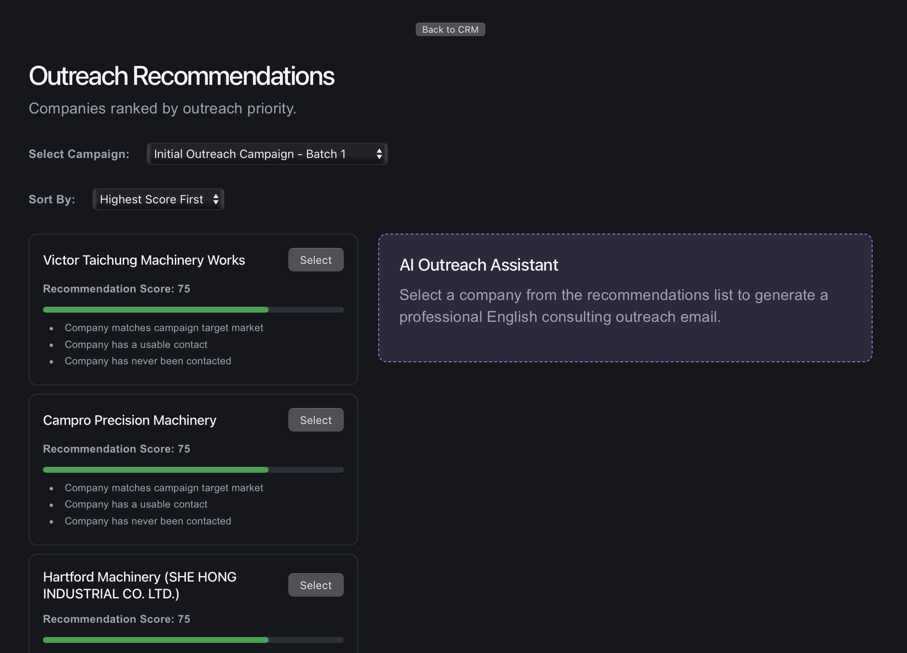
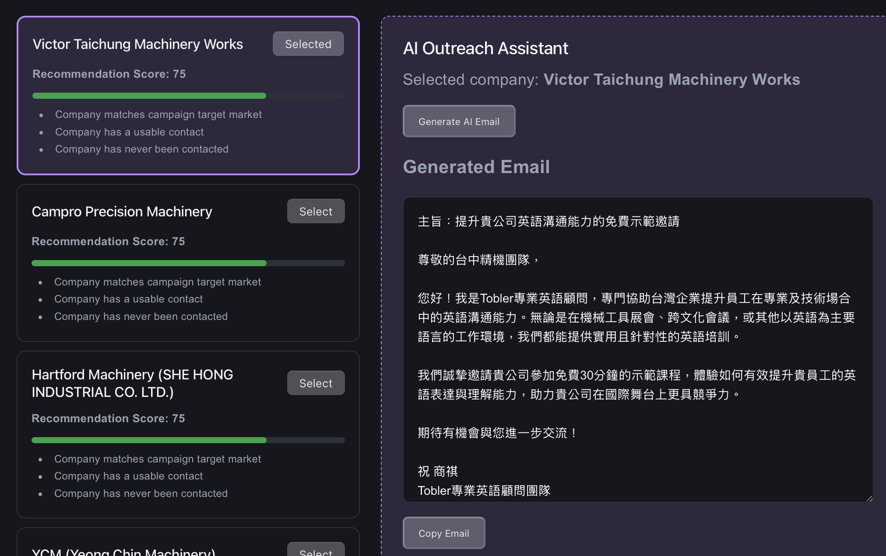

# Tobler Modernization Lab

**Full-Stack Application Modernization | Java Spring Boot | TypeScript | React | PostgreSQL | AWS | AI Integration**

**Live Application:** https://toblermodernizationlab.com  
**GitHub:** https://github.com/toblerdev/tobler-modernization-lab

## Project Overview

Tobler Modernization Lab (TML) is a full-stack application modernization and cloud engineering project that demonstrates how traditional enterprise application concepts can be implemented using modern software architectures and technologies.

The project combines a React and TypeScript frontend, a NestJS REST API, a Java/Spring Boot microservice, PostgreSQL, AI-assisted functionality, and AWS cloud infrastructure.

TML originated as a practical business application for identifying and managing potential corporate clients for Technical and Professional English consulting services in Taichung, Taiwan.

The application supports company and contact management, marketing campaigns, outreach tracking, intelligent prospect recommendations, and AI-generated outreach drafts.

Beyond its business purpose, TML serves as a hands-on modernization laboratory for bridging experience with legacy IBM i (AS/400), RPG, and DB2 systems into contemporary application development.

The project emphasizes practical engineering skills, including:

- Full-stack application development
- REST API and microservice integration
- Java and TypeScript backend development
- Relational database design and migration
- Configurable business rules
- AI integration using Spring AI
- AWS cloud infrastructure
- CI/CD and deployment automation
- Automated testing
- Operational reliability, backup, and recovery

TML is an actively maintained learning and portfolio project designed to demonstrate working implementations of modern enterprise software practices.

---

## System Architecture

```text
                         Internet
                            |
                       Cloudflare
                       DNS / HTTPS
                            |
                            v
                       AWS Elastic IP
                            |
                            v
                          Nginx
                       Reverse Proxy
                        /        \
                       v          v
                 React / Vite   NestJS API
                 TypeScript     TypeScript
                                    |
                       +------------+------------+
                       |                         |
                       v                         v
                    TypeORM                  REST / HTTP
                       |                         |
                       v                         v
                   PostgreSQL             Java Spring Boot
                   CRM Database           Recommendation
                                          Microservice
                                                |
                                      +---------+---------+
                                      |                   |
                                      v                   v
                                  Scoring Engine      Spring AI
                                                          |
                                                          v
                                                       OpenAI

                   PostgreSQL
                       |
                 Daily pg_dump
                       |
                       v
                    Amazon S3

                   PostgreSQL
                       ^
                       |
              Daily Demo Data Reset
                  systemd Timer
```

### Architectural Responsibilities

**React Frontend**

Provides the user interface for CRM management, campaign-based recommendations, and AI-assisted outreach drafting.

**NestJS Backend**

Serves as the primary application API, manages PostgreSQL persistence through TypeORM, retrieves campaign and company information, and coordinates communication with the recommendation microservice.

**Java/Spring Boot Microservice**

Implements the recommendation scoring engine and AI outreach drafting functionality. It exposes REST endpoints consumed by the NestJS backend.

**PostgreSQL**

Stores companies, contacts, campaigns, outreach history, scoring rules, and campaign-specific rule overrides.

**Spring AI**

Integrates generative AI capabilities into the Java service to produce professional English consulting outreach drafts.

**AWS Infrastructure**

Hosts the application and database, manages application traffic, supports automated deployments, and provides off-instance database backups.

---

## Application Features

### 1. CRM Management

TML includes a CRM-style application for managing organizations, business contacts, marketing campaigns, and outreach activity.

**Companies**

Stores organizations identified as potential consulting clients.

Key fields include company ID, company name, office location, target group, and creation timestamp.

**Contacts**

Stores company-associated contacts, including names, job titles, email addresses, phone numbers, and LinkedIn URLs.

**Campaigns**

Defines outreach initiatives, target markets, descriptions, and campaign dates.

**Outreach Events**

Tracks communication history, outreach status, dates, follow-up schedules, and notes.

The relational database maintains foreign-key relationships between CRM entities.

### 2. Java Recommendation Scoring Engine — TML-42

TML includes a recommendation engine implemented in Java and Spring Boot.

The engine evaluates companies against configurable business rules and produces ranked recommendations to help prioritize outreach.

The scoring model supports:

- Target market matching
- Availability of usable contact information
- Companies without prior outreach
- Overdue follow-up activity
- Follow-ups due on the evaluation date

Each supported rule contributes a weighted score when its conditions are satisfied.

Example default scoring rules:

| Rule | Default Weight |
|---|---:|
| Target Market Match | 25 |
| Contact Available | 15 |
| Never Contacted | 20 |
| Follow-up Overdue | 25 |
| Follow-up Due Today | 15 |

The engine returns ranked companies with numeric scores and human-readable explanations.

Scoring logic is implemented in Java, while rule configuration is maintained in PostgreSQL.

Global defaults can be overridden for individual campaigns, allowing scoring behavior to be adjusted without modifying the Java scoring algorithms.

### 3. NestJS and Spring Boot Integration — TML-43

The project demonstrates integration between two backend technology stacks.

NestJS manages database access and prepares recommendation requests. Java/Spring Boot evaluates the business rules and returns ranked results.

**Recommendation request flow:**

```text
React Recommendations Dashboard
               |
               v
          NestJS API
               |
               v
     PostgreSQL CRM Data
               |
               v
    Build Scoring Request
               |
               v
    Java Spring Boot API
               |
               v
      Evaluate Rules
               |
               v
     Ranked Recommendations
               |
               v
          NestJS API
               |
               v
         React Dashboard
```

The integration uses REST APIs and structured request/response DTOs.

This architecture separates data persistence and application orchestration from specialized business-rule evaluation.

It also demonstrates an incremental modernization approach in which applications written in different languages can cooperate through well-defined service contracts.

### 4. React Recommendations Dashboard — TML-50

The Recommendations Dashboard provides a user interface for evaluating and prioritizing outreach opportunities.

Capabilities include:

- Campaign selection
- Retrieval of live CRM company data
- Generation of ranked company recommendations
- Weighted recommendation scores
- Human-readable scoring explanations
- Search and filtering
- Sorting by recommendation score
- Loading and error handling

The dashboard consumes the NestJS API, which coordinates recommendation processing through the Java microservice.

### 5. AI Outreach Assistant — TML-48

TML integrates generative AI into the outreach workflow using Spring AI and OpenAI.

The assistant generates draft outreach messages for Tobler Professional English Consulting.

The feature supports the application's original business purpose: helping identify and communicate with potential corporate clients interested in professional English language training and consulting services.

The Java service exposes an AI drafting endpoint:

```http
POST /ai/outreach-draft
```

The assistant uses supplied business context to prepare a professional outreach draft.

AI-generated messages are intended for human review and editing before use.

The integration demonstrates:

- Spring AI integration with a Java application
- REST-based AI service access
- Prompt design for a defined business use case
- AI-assisted business workflow development
- Separation of AI functionality from the primary CRM backend

### 6. Recommendations Dashboard and AI Assistant Redesign — TML-55

The redesigned interface combines recommendation analysis and AI-assisted outreach drafting into a more cohesive workflow.

The interface is organized around two related activities:

**Recommendation Analysis**

Users review prioritized companies, recommendation scores, and scoring explanations.

**AI Outreach Drafting**

Users prepare outreach messages using the AI assistant while working within the recommendations workflow.

The redesign improves the relationship between data-driven prospect selection and AI-assisted communication.

It also demonstrates frontend component development, state management, API integration, and practical user-interface design using React and TypeScript.

### 7. Automated Demo Data Restoration — TML-57

TML provides a publicly accessible demonstration environment.

Company names and locations are used to demonstrate realistic CRM workflows, while contact information is synthetic demonstration data.

Because visitors can interact with the application, TML includes an automated PostgreSQL restoration process that returns the CRM dataset to a defined baseline.

**Restoration schedule:** Daily at 08:00 UTC.

The implementation uses a Bash restoration script, a version-controlled SQL baseline, and a systemd service and timer.

Restoration includes:

1. Beginning a PostgreSQL transaction.
2. Acquiring a transaction-scoped advisory lock.
3. Clearing the six CRM tables.
4. Reimporting the baseline dataset.
5. Restarting the associated database sequences.
6. Validating restored record counts.
7. Committing the transaction only after successful validation.

The baseline includes 105 companies, 25 contacts, four campaigns, three outreach events, five recommendation rules, and one campaign rule override.

A failed restoration causes the transaction to roll back, protecting the database from a partially restored dataset.

The restoration script also restricts permitted database targets and requires explicit authorization when operating against the production database.

This feature demonstrates database automation, transactional recovery, repeatable demo environments, and Linux systemd administration.

**Note:** Demo data restoration is separate from disaster-recovery backups. Changes made to the public demonstration data are temporary and may be overwritten during the next scheduled reset.

---


## Application Screenshots

### Recommendations Dashboard

The React Recommendations Dashboard displays ranked companies
based on configurable scoring rules evaluated by the Java
Spring Boot microservice.



### AI Outreach Assistant

The AI Outreach Assistant uses Spring AI and OpenAI to generate
professional English consulting outreach drafts.



## Database Architecture

**Database:** `modernization_lab`  
**Application user:** `tml_app`  
**Primary schema:** `crm`

### CRM Tables

| Table | Purpose |
|---|---|
| `companies` | Organization records |
| `contacts` | Company-associated contacts |
| `campaigns` | Marketing and outreach campaigns |
| `outreach_events` | Communication history and follow-up tracking |
| `recommendation_rules` | Configurable recommendation scoring rules |
| `campaign_rule_overrides` | Campaign-specific scoring configuration |

PostgreSQL provides relational integrity through primary keys, foreign keys, and schema constraints.

NestJS uses TypeORM for persistence and database interaction.

The Java recommendation service receives the data required for scoring through REST requests rather than directly querying PostgreSQL.

This separation allows business logic and persistence responsibilities to evolve independently.

---

## Technology Stack

| Layer | Technologies |
|---|---|
| Frontend | React, TypeScript, Vite, CSS |
| Primary Backend | Node.js, NestJS, TypeScript |
| Microservice | Java 21, Spring Boot, Maven |
| AI Integration | Spring AI, OpenAI |
| Database | PostgreSQL, SQL, TypeORM |
| API Integration | REST, HTTP, JSON, DTOs |
| Cloud Hosting | AWS EC2, Amazon Linux |
| Storage and Backup | Amazon S3, PostgreSQL `pg_dump` |
| Web Infrastructure | Nginx, Cloudflare, HTTPS, Elastic IP |
| Process Management | PM2, systemd |
| CI/CD | GitHub Actions, AWS IAM/OIDC, AWS Systems Manager |
| Development | Git, GitHub, VS Code, Postman |
| Project Management | Jira, Kanban |

---

## AWS Production Deployment

TML runs on an Amazon Linux EC2 instance.

The deployment architecture includes:

- AWS EC2 application hosting
- PostgreSQL database hosting
- Elastic IP for a stable public address
- Nginx web server and reverse proxy
- Cloudflare DNS and HTTPS
- PM2 for Node.js process management
- GitHub Actions for CI/CD
- AWS Systems Manager for deployment operations
- IAM role-based authentication
- Amazon S3 for database backups
- systemd for scheduled maintenance tasks

**Production URL:** https://toblermodernizationlab.com

### CI/CD Pipeline

The project uses GitHub Actions to automate validation and deployment activities.

The workflow incorporates automated checks, AWS authentication using OpenID Connect, and AWS Systems Manager for remote deployment operations.

The deployment process uses versioned release directories and activation scripts.

This approach supports controlled production changes, repeatable releases, and post-deployment verification.

Production changes follow an established deployment window.

### Application Configuration

Runtime configuration and secrets are kept outside the version-controlled application source.

Production backend configuration is maintained separately from application releases.

Sensitive credentials and API keys are not committed to the repository.

---

## Database Backup and Recovery

TML implements automated PostgreSQL backups using `pg_dump`, systemd, and Amazon S3.

The backup process:

1. Creates a timestamped PostgreSQL database dump.
2. Stores the backup in a protected local directory.
3. Uploads the backup to Amazon S3.
4. Uses an EC2 IAM role instead of stored AWS access keys.
5. Applies a 30-day S3 backup retention policy.

**Backup schedule:** Daily at 00:00 UTC.

Database recovery has been tested using an isolated PostgreSQL test database.

The recovery procedure verifies that database backups can be restored without overwriting the active production database.

### Backup vs. Demo Restoration

TML maintains two separate operational processes:

| Process | Purpose | Schedule |
|---|---|---|
| Database Backup | Preserve recoverable database snapshots | 00:00 UTC daily |
| Demo Data Restoration | Restore public CRM demonstration data | 08:00 UTC daily |

The backup system protects against data loss.

The demo restoration system maintains a consistent, repeatable public demonstration environment.

---

## Security and Reliability

TML incorporates operational practices intended to support secure and reliable application delivery.

Implemented capabilities include:

- HTTPS access
- Cloudflare reverse proxy
- IAM role-based AWS authentication
- OIDC-based GitHub Actions authentication
- Restricted S3 backup access
- Externalized runtime configuration
- Automated PostgreSQL backups
- Database recovery testing
- Transactional demo data restoration
- PostgreSQL advisory locking
- Automated application testing
- CI/CD validation
- Controlled production deployment procedures
- Post-deployment health verification

These practices provide practical experience with operational concerns beyond application feature development.

---

## Project Structure

```text
postgres-modernization-lab/
|
|-- frontend/
|   |-- src/
|   |   |-- components/
|   |   |-- App.tsx
|   |   |-- main.tsx
|   |-- public/
|   |-- package.json
|   |-- vite.config.ts
|
|-- backend/
|   |-- src/
|   |   |-- crm/
|   |   |-- recommendations/
|   |   |-- app.module.ts
|   |   |-- main.ts
|   |-- package.json
|
|-- outreach-recommendation-service/
|   |-- src/
|   |   |-- main/
|   |   |-- test/
|   |-- pom.xml
|   |-- mvnw
|
|-- sql/
|   |-- demo/
|   |   |-- baseline.sql
|
|-- scripts/
|   |-- restore-demo-data.sh
|
|-- systemd/
|   |-- tml-demo-reset.service
|   |-- tml-demo-reset.timer
|
|-- .github/
|   |-- workflows/
|
|-- README.md
```

The repository separates frontend, backend, microservice, database, and operational components.

---

## Testing and Quality Assurance

TML includes automated testing across its backend services.

**NestJS**

Automated tests validate backend service behavior, API request handling, and recommendation integration.

**Java/Spring Boot**

JUnit-based tests verify recommendation scoring behavior, supported rule conditions, and REST controller responses.

**PostgreSQL Restoration**

The demo restoration process has been tested against an isolated database, including repeated execution and transaction rollback following a deliberately introduced SQL failure.

**CI/CD**

GitHub Actions executes automated validation checks before changes are merged and deployed.

Testing is an ongoing part of the development process, with emphasis on business logic correctness, integration reliability, and operational safety.

---

## Modernization Objectives

TML is designed to demonstrate the transition from traditional enterprise application concepts to contemporary software engineering practices.

The project builds on experience with IBM i, RPG, CL, and DB2 while exploring modern approaches to application design.

Key modernization concepts include:

**API-Driven Architecture**

Business capabilities are exposed through REST interfaces rather than tightly coupled application components.

**Microservice Integration**

Java/Spring Boot and TypeScript/NestJS services communicate through structured API contracts.

**Configurable Business Rules**

Scoring configuration is stored in PostgreSQL while rule evaluation remains implemented in Java.

**AI-Augmented Workflows**

Generative AI is integrated into an existing business process rather than presented as a standalone demonstration.

**Cloud Deployment**

Applications are deployed and maintained using AWS infrastructure, automated workflows, and operational monitoring.

**Reliability and Recovery**

Database backups, transactional restoration, automated testing, and controlled deployment procedures support dependable application operation.

---

## Development Roadmap

TML remains an evolving project and a platform for continued technical learning.

Potential future improvements include:

- Containerization with Docker
- Expanded integration and end-to-end testing
- Additional application monitoring and observability
- Enhanced campaign management and analytics
- Further AI-assisted CRM capabilities
- Additional security and dependency maintenance
- Continued user-interface refinements

The roadmap prioritizes practical engineering value and opportunities to explore technologies relevant to enterprise application modernization.

---

## Project Status

**Production — Active Development and Continuous Improvement**

Tobler Modernization Lab is deployed to AWS and accessible through its public HTTPS domain.

The application includes CRM management, a Java/Spring Boot recommendation scoring microservice, a React Recommendations Dashboard, NestJS service integration, Spring AI outreach drafting, and automated PostgreSQL demo data restoration.

The project demonstrates end-to-end ownership of a full-stack application, from database design and business logic to cloud deployment, CI/CD, and operational reliability.

TML continues to serve both as a practical business application and as a technical portfolio showcasing modern software engineering, system integration, and application modernization skills.

---

## Author

**Tobler Modernization Lab**

GitHub: https://github.com/toblerdev  
Website: https://toblermodernizationlab.com
